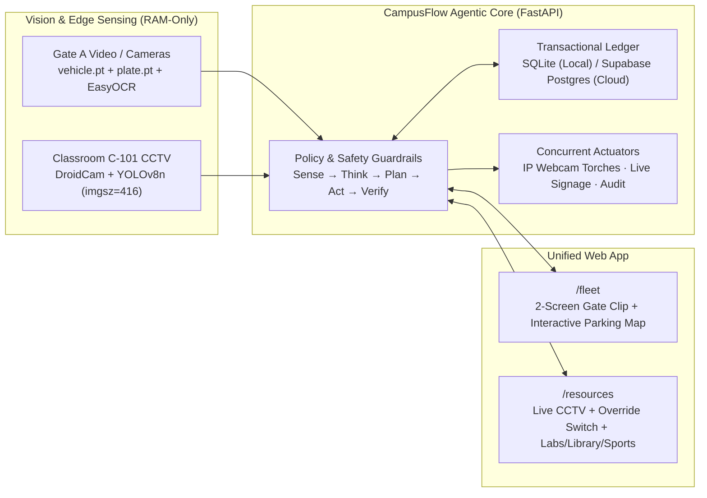

# CampusFlow

**Agentic AI for Smarter Campus Mobility & Resource Operations**  
*MARTIAN 1.0 Hackathon · BMSITM · Management Track 4 (Open Innovation)*

CampusFlow is a closed-loop, vision-driven agentic operations platform that turns ordinary existing campus cameras into **real-time parking intelligence** and **autonomous classroom energy & shared-resource governance** — with transparent human-in-the-loop guardrails, zero black-box decisions, and zero expensive per-bay hardware retrofits.

---

## System Architecture



---

## Core Capabilities

### 1. Vehicle Fleet Management (`/fleet`)
- **2-Screen Operations View:** Left screen plays raw gate video clips sequentially via **Load Clip**; right screen renders the live top-down BMSITM Gate A parking map (`30` car bays incl. `2` ♿ accessible bays, `64` main bike bays, `18` Bike Zone 2 perimeter bays, and Car Overflow corridor).
- **Real Vision Pipeline (`vehicle.pt` + `plate.pt` + EasyOCR):** Runs on CUDA GPU (with CPU fallback) to lock onto the primary foreground vehicle, extract/assign its license plate, wait **3.0 seconds** after detection, and automatically trigger entry (`+ Car` / `+ Bike`, saved under the assigned bay) or exit (`− Car`, freeing the bay).
- **Transparent Guardrails:** Live 4-step **AI Decision** trace (`Sense → Think → Act → Explain & Verify`), **Duplicate Scan Guard**, protected ♿ bays, automatic **Bike Zone 2** redirect via `SIGN_JUNCTION`, and **human-in-the-loop Attendant Approval** before opening Car Overflow.

### 2. Classroom & College Resource Management (`/resources`)
- **Embedded Live CCTV (`DroidCam` + `YOLOv8n`):** Streams real-time annotated person bounding boxes directly inside the web app with **RAM-only processing** (zero frames written to disk).
- **Wireless Appliance Control (Concurrent HTTP):**
  - **Dual-Action Override Switch:** Toggles classroom lights/torches **ON ↔ OFF** concurrently across multiple wireless Android relays (`1.5s` fault-tolerant background threads).
  - **No Auto-ON / Debounced Auto-OFF:** Sitting in a room with lights OFF never forces appliances ON; when lights are ON and everyone leaves past the `3.0s` hold timer, appliances automatically switch **OFF** to eliminate energy waste.
- **Full Auditability & Campus Workflows:** Live **Incident Log** (with **Clear** control) plus transactional **Labs**, **Library seats** (with FIFO waitlist & protected seat switching), and **Sports equipment** checkout/inspection workflows.

---

## Quickstart

### Run Locally
```powershell
# Activate / use the project virtual environment from E:\Starforge\MARTIAN
E:\Starforge\MARTIAN\prototype\.venv\Scripts\python.exe -m uvicorn --app-dir E:\Starforge\MARTIAN prototype.app:app --host 127.0.0.1 --port 8765
```
Open:
- **Home:** `http://127.0.0.1:8765/`
- **Vehicle Fleet:** `http://127.0.0.1:8765/fleet`
- **College Resources:** `http://127.0.0.1:8765/resources`

### Run Automated Test Suite (`33/33` active tests)
```powershell
E:\Starforge\MARTIAN\prototype\.venv\Scripts\python.exe -B -m unittest discover -s E:\Starforge\MARTIAN\prototype -t E:\Starforge\MARTIAN -v
```

### Cloud Simulation Deployment (Vercel + Supabase)
Configured out of the box via [server.py](server.py) and [vercel.json](vercel.json) with isolated per-session PostgreSQL persistence and Row-Level Security (RLS). See [prototype/README.md](prototype/README.md#deploy-on-vercel).

---

## Round 2 Evaluation Dossier (`round 2/`)

In-depth judge documentation tailored to the 100-mark Round 2 rubric:

| Criterion | Weight | Deep-Dive Document |
| :--- | :---: | :--- |
| **1. Explainability** | 25% | [round 2/01_EXPLAINABILITY.md](round%202/01_EXPLAINABILITY.md) |
| **2. Efficiency of Deployable Solution** | 25% | [round 2/02_EFFICIENCY_AND_DEPLOYABILITY.md](round%202/02_EFFICIENCY_AND_DEPLOYABILITY.md) |
| **3. Revenue Beyond College** | 25% | [round 2/03_REVENUE_BEYOND_COLLEGE.md](round%202/03_REVENUE_BEYOND_COLLEGE.md) |
| **4. Baseline Comparison** | 25% | [round 2/04_BASELINE_COMPARISON.md](round%202/04_BASELINE_COMPARISON.md) |

---

## Additional Project Docs
- [Fleet Management Spec](solution/FLEET_MANAGEMENT.md) · [Agentic Architecture](solution/AGENTIC_ARCHITECTURE.md) · [Prototype Design](solution/PROTOTYPE_DESIGN.md)
- [Demo Storyboard](presentation/DEMO_STORYBOARD.md) · [Judge Q&A](presentation/JUDGE_QA.md) · [Prototype README](prototype/README.md)
