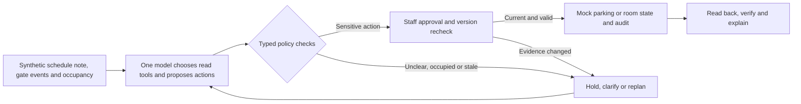

# CampusFlow agentic architecture

## Slide diagram

**Stack.** Local HTML/JavaScript UI, FastAPI/Pydantic, SQLite and one team-approved function-calling model API. For the first fixture, replay synthetic video frames or a team-created synthetic count event stream and display how that input was produced. If the existing workspace provides a reliable compatible model credential, validate one structured request before committing to the provider. [FastAPI response models](https://fastapi.tiangolo.com/tutorial/response-model/) · [SQLite transactions](https://sqlite.org/lang_transaction.html) · [Example function calling](https://aistudio.google.com/docs/function-calling)

| Stage | Example and authority |
| --- | --- |
| **Sense** | Sample note plus timestamped gate events and fresh room occupancy. Gate IDs, room IDs, counts and timestamped schedule revisions form case evidence. |
| **Think** | Parse the requested change. Call `lookup_session` to disambiguate end time, then `get_parking_state` and `get_room_context` for capacity and former room. A missing or conflicting source triggers `request_clarification`. |
| **Act** | `propose_overflow` stages one time-limited allocation. `propose_room_standby` stages a room action independently. The server exposes dedicated staff approvals for these actions. Deterministic normal slot allocation and release run on typed gate events. The model has no direct write tool. |
| **Explain** | Show the schedule version and cited availability, why alternate actions were rejected and which user or role approved the chosen action. Use structured reason codes and evidence IDs. |
| **Verify** | Read back the booking or simulated device state. A transaction commits the approved update with its audit entry. A failed verification leaves a visible needs-review status. |
| **Adapt** | When occupancy changes, invalidate only the room proposal. Await a new continuous fresh vacancy interval and new approval. Keep the verified parking branch. If the agent cannot resolve the uncertainty, assign the case to the responsible staff role. |

**Data and validation.** Use one incident key plus per-resource version or equivalent evidence snapshot; keep action records independent. Restrict inputs to typed IDs and timestamps. Validate allowed event transitions. An event ID is idempotent, so duplicate arrivals or exits do not change free-space count twice. A used overflow bay remains occupied until confirmed exit. Expiry closes the window for new assignments and releases unused holds only. Priority is eligibility followed by first valid arrival. A stale frame, any person count above zero, a protected booking or a manual override blocks room action. Safety equipment is outside this device policy.

**Reliability and privacy.** Keep no personal data and no video frames in the decision datastore. Process synthetic frames transiently and save only counts, confidence and time. Treat note text as untrusted data. Restrict the model to the allowlisted tools and validate outputs server-side. Start with at most two model turns per attempt and one bounded retry when time permits. Measure actual timings. On timeout use staff-confirmed structured inputs and the same checks. Label manual intake as fallback and keep writes behind policy and approval.
