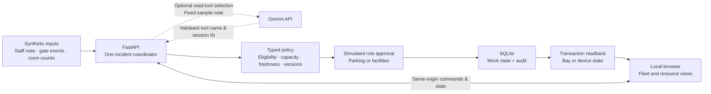
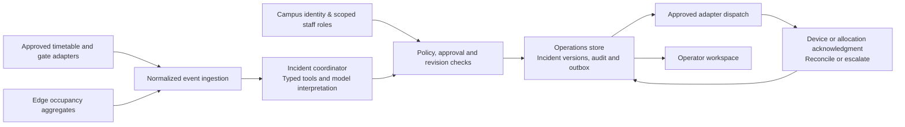
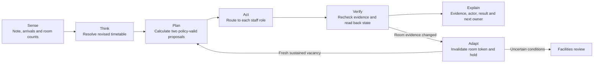
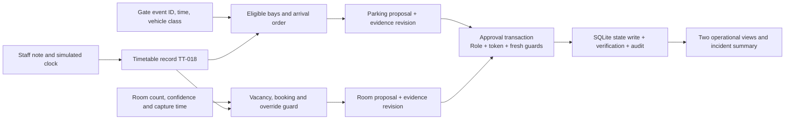
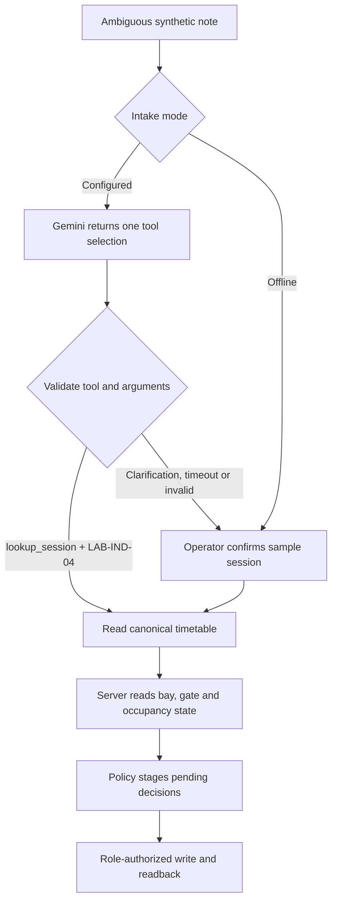
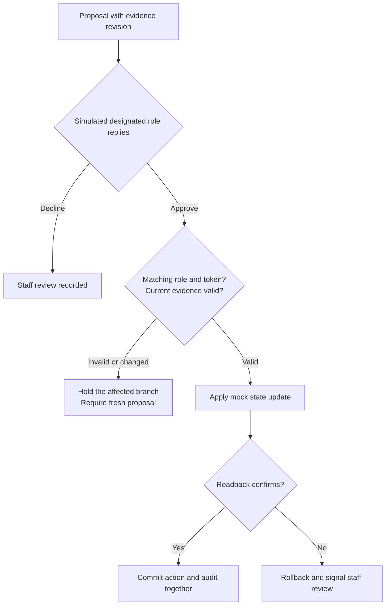
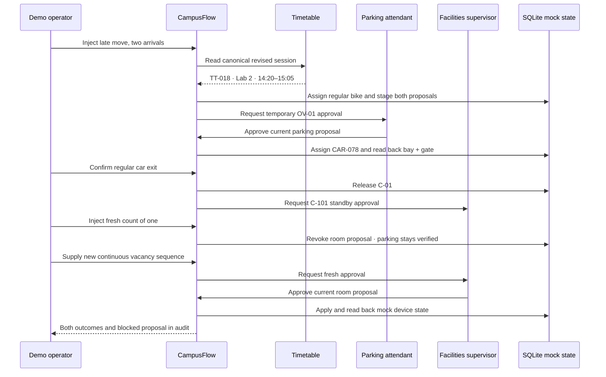

# CampusFlow technical diagrams

The prototype diagrams describe the local implementation. The final-product diagram describes proposed components. The browser captures and slide-ready exports are indexed in the [demonstration storyboard](../presentation/DEMO_STORYBOARD.md).

## 1. High-level system architecture

**Local presentation prototype**

**Proposed final product**

## 2. Agentic workflow

## 3. Data flow

## 4. Agent tools and authority

## 5. Human decision flow

## 6. End-to-end scenario sequence

