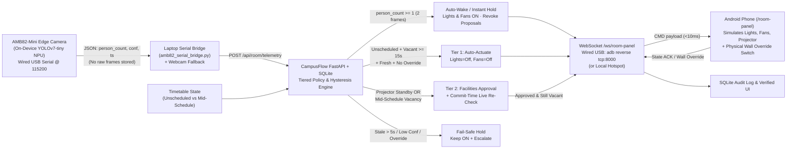

# CampusFlow · Classroom Resource Management (Hardware-in-the-Loop)

**MARTIAN 1.0 · Management Track 4 · Open Innovation · Agentic AI for Campus Wellness**

---

## 1. Main Agenda & Problem Framing

When classes relocate on short notice (for example, an afternoon lab induction moving from **C-101** to **Lab 2**), classrooms are frequently left empty with **lights, ceiling fans, and projectors** running until a custodian checks the floor manually.

A simple motion sensor or blind timer does not solve this safely on a real campus:
* **Static seated students** during lectures or exams trigger false "empty" readings on PIR motion sensors.
* **Projectors cannot be hard-cut** repeatedly without risking lamp cooldown damage; they must transition to **Standby** only under verified rules.
* **Mid-schedule lulls** (a class starting 15 minutes late or stepping out briefly) should never cause an automatic blackout while a session is still booked.
* **Staff overrides and failed commands** must be respected and verified rather than assumed.

**Agenda for Classroom Resource Management:** Replace pure software simulation with an **end-to-end, wired-first, privacy-preserving hardware loop** using an **AMB82-Mini** edge AI camera plugged into the laptop and an **Android phone** acting as an instant, closed-loop classroom appliance controller (**Lights, Fans, Projector + Wall Override**) managed by CampusFlow's tiered Agentic AI policy engine.

*(Companion shared-resource inventories—Lab bookings, Library seats, and Sports equipment checkout—remain tracked in the same CampusFlow SQLite backend as synthetic transactional records, clearly distinguished from the live hardware classroom loop.)*

---

## 2. Target Outcomes & Measurable Success Criteria

| Outcome | Target / Verification Metric |
| --- | --- |
| **Instant Hardware Triggering** | End-to-end latency from approved/auto decision on laptop → WebSocket push → Android appliance state change → verified `ACK` logged in SQLite **< 150 ms** over wired USB (`adb reverse`). |
| **Zero False Shutdowns** | **0** appliance shutoffs when `person_count >= 1`, feed is stale (`> 5 s`), confidence is uncertain (`< 0.55`), or phone **Wall Manual Override** is active. |
| **Commit-Time Stale Approval Blocking** | If a person re-enters the AMB82 frame *after* a Tier-2 proposal is raised and *before* Facilities clicks Approve, the server rejects the stale approval (`HTTP 409`) and keeps appliances **On**. |
| **Tiered Autonomy Demonstrated Live** | Clearly proves **Auto-Wake/Hold** on occupancy, **Tier-1 Auto-Off** (Lights & Fans when unscheduled + sustained vacancy), and **Tier-2 Approval-Gated** control (Projector `Standby` or mid-schedule vacancy). |
| **Closed-Loop Readback (`ACK`)** | Laptop never marks appliances `Off`/`Standby` optimistically; state commits as verified only upon receiving a matching `ack` payload from the Android controller (missing `ACK` raises `NEEDS_REVIEW`). |
| **Privacy by Architecture** | **Zero saved video frames, zero facial recognition, zero PII.** On-device AMB82 NPU sends only numeric occupancy counts (`person_count`, `confidence`, `ts`) over USB Serial. |

---

## 3. End-to-End Hardware-in-the-Loop Workflow



### Sense → Think → Act → Verify → Adapt Mapping

1. **Sense:** AMB82-Mini NPU runs person detection on-device and streams compact JSON readings over USB Serial to `amb82_serial_bridge.py`, which forwards typed telemetry to FastAPI alongside the current timetable state and Android phone wall-override state.
2. **Think:** Deterministic server rules evaluate freshness (`age <= 5 s`), confidence (`>= 0.55`), asymmetric hysteresis (fast wake on `2` occupied frames vs. `15 s` sustained vacancy demo window), schedule status (`class_scheduled: true/false`), and manual override.
3. **Act (Tiered Policy):**
   * **Occupancy detected:** Auto-wake/hold Lights & Fans `On`, revoke any open power-down proposal immediately.
   * **Tier 1 (Unscheduled + Sustained Vacancy):** Auto-send `Lights=Off, Fans=Off` immediately over WebSocket to the Android phone.
   * **Tier 2 (Sensitive):** Propose **Projector → `Standby`** (lamp cooldown protection) or any **mid-schedule vacancy shutdown** to the Facilities Supervisor for explicit approval.
4. **Verify:** Commit-time re-check confirms the room is still vacant, fresh, and not overridden; after pushing the WebSocket command, FastAPI waits for the Android phone's **state `ACK`** and writes the verified transition + evidence into the chronological audit log.
5. **Adapt:** If a student walks back into view mid-approval, the camera stalls, the wall override is toggled on the phone, or the phone fails to `ACK`, CampusFlow cancels/blocks the transition, keeps devices safe, and alerts Facilities staff.

---

## 4. Component Blueprint & Wired-First Transport

### 4.1 Edge Sensing — AMB82-Mini (Wired USB Serial First)
* **Why wired USB Serial instead of RTSP:** RTSP introduces 1–3 seconds of encoding/buffering lag and depends on venue Wi-Fi (which often enforces AP client isolation). Plugging the AMB82-Mini via USB-C and running AmebaPro2's built-in **YOLOv7-tiny NPU** (`ObjectDetectionLoop`, filtered to COCO class `0: person`) streams JSON lines at `115200` baud with **< 30 ms latency** and **zero video frames leaving the camera**.
* **Expected Serial Line Format (1 line per reading, ~2–5 Hz):**
  ```json
  {"room":"C-101","person_count":0,"confidence":0.92,"source":"amb82-npu"}
  ```
* **Phase-2 Optional Hotspot Mode:** Once wired USB is verified, an optional local phone hotspot can carry AMB82 RTSP/MJPEG preview + laptop `YOLOv8n` (`ultralytics`, COCO class `0: person`, ~6 MB offline) if judges want a live bounding-box preview.
* **Demo Safety Fallback:** `amb82_serial_bridge.py` supports `--mode serial` (AMB82 COM port), `--mode sim` (interactive keyboard/scripted test telemetry), and `--mode webcam` (optional OpenCV/YOLOv8n fallback) so a hardware hiccup at the table never stalls the demo.
* **Judging-Table Framing Rule:** Aim the AMB82 at a bounded desk/diorama zone away from hallway foot traffic so passersby do not accidentally keep `person_count >= 1` during the vacancy demonstration.

### 4.2 Tiered Policy Rules (Server-Side Hard Invariants)

| Condition | Lights & Fans | Projector | Approval Required? |
| --- | --- | --- | --- |
| `person_count >= 1` (2 consecutive frames, `conf >= 0.55`) | **Auto-Wake / Hold `On`** | **Hold Current (`On`)** | No (Immediate safety/comfort wake; revokes pending proposals) |
| Vacant `>= 15 s` + **No class scheduled** + Fresh + No override | **Auto-Shutdown `Off`** | **Propose `Standby`** | Lights/Fans: **Auto (Tier 1)** · Projector: **Facilities Approval (Tier 2)** |
| Vacant `>= 15 s` + **Class IS scheduled** + Fresh + No override | **Propose `Off`** | **Propose `Standby`** | **Facilities Approval (Tier 2)** for all appliances |
| Feed stale (`> 5 s`), low confidence (`< 0.55`), or Wall Override `ON` | **Fail-Safe Hold (`On`)** | **Fail-Safe Hold (`On`)** | Blocked — escalate to Facilities |
| Emergency / Safety circuits | **Out of Scope / Protected** | — | Never controllable by agent |

### 4.3 Android Phone Appliance Simulator (`/room-panel` via Wired USB `adb reverse`)
* **Fastest Zero-APK Setup:** Served directly by FastAPI at `/room-panel` over WebSocket (`/ws/room-panel`).
* **Wired Connection (Recommended — `< 10 ms`, Zero Wi-Fi Risk):**
  ```powershell
  adb reverse tcp:8000 tcp:8000
  ```
  Open Chrome on the Android phone → navigate to `http://localhost:8000/room-panel` → tap **Fullscreen**.
* **Hotspot Connection (Phase-2 / Wireless):** Connect laptop and phone to the same mobile hotspot and open `http://<laptop-hotspot-ip>:8000/room-panel`.
* **Phone UI Capabilities:**
  * High-contrast visual cards for **Classroom Lights** (warm illuminated state / dark off), **Ceiling Fans** (smooth rotating blades / stopped), and **Projector** (active blue beam / amber `STANDBY` cooldown badge).
  * Tactile **haptic vibration (`navigator.vibrate`) + subtle Web Audio relay click** when state changes arrive.
  * **Physical Wall Manual Override toggle** right on the phone—tapping it sends `{"type":"wall_override","active":true}` over WebSocket to the laptop, immediately forcing a fail-safe hold and revoking any pending proposals.
  * **Closed-Loop `ACK`:** Every incoming command (`cmd_id`) triggers an immediate `{"type":"ack","cmd_id":...,"devices":...}` back to FastAPI, which marks the command verified in the live dashboard and SQLite audit log.

---

## 5. Wire Protocol Contracts

### Telemetry Ingest (`POST /api/room/telemetry`)
```json
{
  "room": "C-101",
  "person_count": 0,
  "confidence": 0.94,
  "source": "amb82-npu"
}
```

### WebSocket Server → Android Phone (`/ws/room-panel`)
```json
{
  "type": "command",
  "cmd_id": "cmd-8f2a1c",
  "room": "C-101",
  "reason": "Tier 1 auto-off: 15s sustained vacancy (unscheduled)",
  "devices": { "Lights": "Off", "Fans": "Off", "Projector": "On" }
}
```

### WebSocket Android Phone → Server (`ACK` & Wall Override)
```json
{ "type": "ack", "cmd_id": "cmd-8f2a1c", "room": "C-101", "devices": { "Lights": "Off", "Fans": "Off", "Projector": "On" } }
```
```json
{ "type": "wall_override", "room": "C-101", "active": true }
```

---

## 6. Judge Q&A & Edge-Case Readiness

| Judge Question / Edge Case | Verified CampusFlow Behavior |
| --- | --- |
| *"Why isn't this just a ₹300 PIR motion sensor?"* | Motion sensors fail on still seated students, hard-cut projector bulbs, and ignore schedules. CampusFlow fuses timetable state + edge person detection + asymmetric vacancy hysteresis + tiered autonomy + commit-time re-verification + closed-loop phone `ACK`. |
| *"What if someone walks in right as Facilities clicks Approve?"* | Server re-evaluates live AMB82 occupancy atomically at commit time, blocks the stale approval (`409`), logs `"Pending standby blocked"`, and leaves all phone appliances **On**. |
| *"What if the camera unplugs or lens is covered?"* | Watchdog detects stale frames (`> 5 s`) or low confidence (`< 0.55`) → Fail-safe holds all appliances **On** and escalates `NEEDS_REVIEW`. |
| *"What about student privacy?"* | AMB82-Mini runs person detection on-device and sends only integer `person_count` and `confidence` over USB Serial. Zero frames, faces, or identities are ever stored or transmitted. |
| *"What if the Android phone disconnects?"* | WebSocket presence shows `DISCONNECTED`; unacknowledged commands stay `UNVERIFIED / NEEDS_REVIEW` instead of falsely reporting `Off`. |

---

## 7. Round 2 Build Sequence & Disclosures

1. **P0 (Core Wired Loop — Tonight):** FastAPI WebSocket hub (`/ws/room-panel`), tiered room controller (`/api/room/live`, `/api/room/telemetry`, `/api/room/approve`, `/api/room/schedule`, `/api/room/reset`), fullscreen Android `/room-panel` appliance UI, and `amb82_serial_bridge.py` (with interactive test mode).
2. **P1 (Hardware Integration):** Flash AMB82-Mini AmebaPro2 `YOLOv7-tiny` Serial JSON sketch, connect Android via `adb reverse tcp:8000 tcp:8000`, and run end-to-end latency + stale-approval tests.
3. **P2 (Optional Wireless Backup):** Test same-hotspot connection (`http://<laptop-ip>:8000/room-panel`) and optional webcam fallback.

**Declared Open-Source Tools & Hardware:** Realtek AMB82-Mini (AmebaPro2 Arduino SDK / YOLOv7-tiny NPU), FastAPI, Pydantic, Uvicorn, SQLite, Python `pyserial`, optional `ultralytics` YOLOv8n / OpenCV, and Android Chrome (`adb reverse`). Zero real campus electrical wiring, zero personal data, and zero real campus system integrations are used.

[Agentic architecture](AGENTIC_ARCHITECTURE.md) · [Prototype design](PROTOTYPE_DESIGN.md) · [Competition rules](../context/RULES_AND_CONSTRAINTS.md) · [Prototype server](../prototype/app.py)
