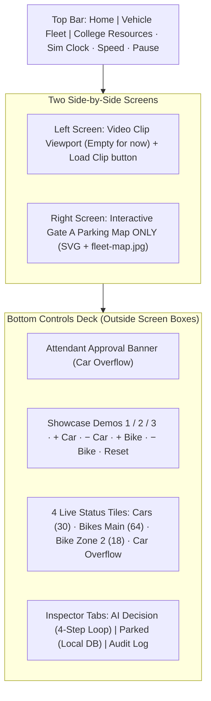

# CampusFlow — Vehicle Fleet Management (`/fleet`)

## 1. Overview
The **Vehicle Fleet Management** workspace (`GET /fleet`) runs CampusFlow's interactive dark-mode parking and gate operations simulation for BMSITM Gate A. It demonstrates an agentic **Sense → Think → Act → Explain & Verify** loop over a live top-down campus floorplan, separating cars and two-wheelers, protecting accessible bays, requiring human-in-the-loop attendant approval for car overflow, and automatically redirecting bikes to Bike Zone 2 when the main bike lot fills.

- **Route:** `GET /fleet` (served directly by [prototype/app.py](../prototype/app.py))
- **Frontend UI & Simulation Engine:** [prototype/static/fleet.html](../prototype/static/fleet.html)
- **Top-Down Floorplan Asset:** [prototype/static/fleet-map.jpg](../prototype/static/fleet-map.jpg) (`1264 × 848` SVG-aligned map)
- **Standalone Reference File:** [presentation/campusflow_parking_sim.html](../presentation/campusflow_parking_sim.html)
- **Data Scope:** 100% synthetic vehicle IDs, bay states, and audit logs; zero real campus integrations or PII saved.

---

## 2. Screen Layout & Architecture



### Left Screen — Sequential Clip Loader
- Remains cleanly empty until video clips are added.
- Includes the **`Load Clip`** button (`#btnLoadClip`) backed by an ordered `CLIP_QUEUE` array inside [prototype/static/fleet.html](../prototype/static/fleet.html).
- **Future clip hookup:** Add clip URLs (for example `'/static/clips/clip1.mp4'`) to `CLIP_QUEUE`; each click of **Load Clip** advances sequentially (`(clipIndex + 1) % CLIP_QUEUE.length`) and plays the next clip inside `#clipPlayer`.

### Right Screen — Interactive Campus Parking Map
- Displays **only** the live floorplan (`#simSvg` over `/static/fleet-map.jpg`), compact live status pill (`#storyPill`), and bottom legend (`Open`, `Parked (Click to exit)`, `♿ Accessible`, `3 Cameras`).
- **Two-way Gate A Lanes:** `ENTRY ▲` on the left lane, `▼ EXIT` on the right lane.
- **Click-to-Exit:** Clicking any parked car or bike directly on the map animates it out through the right Exit lane, frees the bay, updates `SIGN_JUNCTION`, and removes it from the parked DB.

---

## 3. Cameras, Signage & Parking Zones

### Vision Cameras (Simulated)
| Camera | Location | Role |
| :--- | :--- | :--- |
| **`CAM-1`** | Main Gate (`x=633, y=696`) | Monitors left Entry & right Exit lanes; flags duplicate scans before DB corruption |
| **`CAM-2`** | Car Lot (`x=748, y=498`) | Verifies all 30 car bays and commits bay occupancy readback |
| **`CAM-3`** | Bike Lot (`x=356, y=568`) | Verifies 64 main bike bays and triggers Bike Zone 2 perimeter redirect when full |

### Live Digital Signboard (`SIGN_JUNCTION`)
- Mounted at the main approach junction; updates dynamically as lot capacities change:
  - `BIKE LOT 1: OPEN (LEFT)` ↔ `BIKE LOT 1 FULL → ZONE 2 (RIGHT)`
  - `CAR LOT: OPEN (RIGHT)` ↔ `CAR LOT FULL → OVERFLOW ↗`
- Clicking `SIGN_JUNCTION` jumps directly to the **Audit** tab in the bottom inspector.

### Zone Capacities & Policies
| Zone | Bay IDs | Capacity | Policy |
| :--- | :--- | :---: | :--- |
| **Car Lot (`ZONE_CAR`)** | `C-A01`..`C-A10`, `C-B01`..`C-B10`, `C-C01`..`C-C10` | **30** | Includes **2 protected ♿ Accessible bays** (`C-A09`, `C-A10`); never auto-assigned to general cars |
| **Main Bike Lot (`ZONE_BIKE_1`)** | `B1-01`..`B1-64` | **64** | Left of Gate A approach (West, East, and Bend aisles) |
| **Bike Zone 2 (`ZONE_BIKE_2`)** | `B2-01`..`B2-18` | **18** | Right perimeter reserve; starts `LOCKED` (`Standby`) and activates automatically when Main Bike Lot is full |
| **Car Overflow Corridor** | Straight ahead → right turn | **Dynamic** | Requires explicit **Attendant Approval** (`Approve Overflow ↗` / `Reject & Exit`) when Car Lot is full |

---

## 4. Agentic Loop, Controls & Showcase Scenarios

All simulation buttons, counters, approvals, and logs sit in the **bottom controls deck outside the two screen boxes**:

1. **Showcase 1 — Car Lot Full → Overflow Approval (`#btnDemo1`):**
   - Fills Car Lot capacity and sends an incoming car to the junction.
   - Holds the vehicle and prompts the **Attendant Approval** banner (`Approve Overflow ↗` routes the car straight ahead and right into the overflow corridor; `Reject & Exit` turns it back out the Exit lane).
2. **Showcase 2 — Bike Lot Full → Right Perimeter Redirect (`#btnDemo2`):**
   - Fills all 64 main bike slots, flips `SIGN_JUNCTION` automatically, unlocks **Bike Zone 2** (`B2-01`..`B2-18`), and routes arriving bikes to the right perimeter bays.
3. **Showcase 3 — Test Duplicate Scan Guard (`#btnDemo3`):**
   - Simulates `CAM-1` scanning an already-parked vehicle ID and demonstrates the guardrail blocking duplicate entry from corrupting the live DB.
4. **Manual Controls:**
   - `+ Car`, `− Car`, `+ Bike`, `− Bike`, `Reset`, `Clear All` (in Parked DB tab), plus top-bar `1.5× / 2.5× / 1× Speed` and `Pause / Resume`.
5. **Inspector Tabs:**
   - **AI Decision:** Live 4-step trace (`1 · Sense`, `2 · Think`, `3 · Act`, `4 · Explain & Verify`).
   - **Parked (Local DB):** Live table of parked vehicles persisted in browser `localStorage` (`campusflow_parking_db_v3`) with per-row `Exit` buttons.
   - **Audit:** Timestamped event log capturing decisions, policies applied, and outcomes.

---

## 5. Running & Verifying Locally

Start the local FastAPI server from the repository root:

```powershell
E:\Starforge\MARTIAN\prototype\.venv\Scripts\python.exe -m uvicorn --app-dir E:\Starforge\MARTIAN prototype.app:app --host 127.0.0.1 --port 8765
```

Open **`http://127.0.0.1:8765/fleet`** in your browser.

Run automated route and prototype verification tests:

```powershell
E:\Starforge\MARTIAN\prototype\.venv\Scripts\python.exe -B -m unittest discover -s E:\Starforge\MARTIAN\prototype -t E:\Starforge\MARTIAN -v
```
